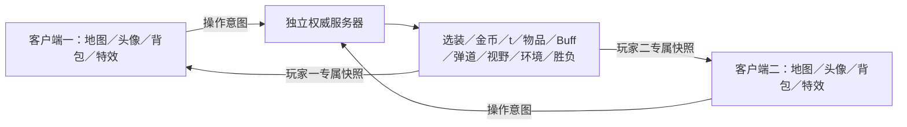

# 权威服务器联机地牢

**2026-10-27对战菜单源码更新（0.0.7／协议11）**：战斗右上角菜单提供对话、暂禁用的发送表情、确认后投降，战斗直接退出按钮已移除。对话及投降由所属房间服务器处理，不暂停或增加思考时间；完整工程与独立客户端同步，尚未重新打包或部署。规则及本机验证见 [battle_menu.md](battle_menu.md)。下列早期版本、菜单投稿入口及构建记录为历史，请以工作区交接文档为准。

**2026-10-24当前源码及新服务器包：0.0.6／协议11；服务器已重建并本地验证，尚未部署，APK未更新。** 主菜单新增地图投稿，
复用菜单连接实现12×12编辑／公开投稿库及服务器持久化；PowerShell按ID删除。
新增RPC需两端配套更新；最新`Deploy/ChaoticDungeon-server-0.0.6.tar.gz`已为协议11，旧协议10包另存备份。
旧服务器出现RPC checksum及`_session`报错时，按[0.0.6部署说明](deploy_0.0.6.md)更新新包。
功能、管理命令和数据目录见[地图投稿](map_submissions.md)。下文各日期对应历史记录。

2026-10-24客户端新增匹配成功手机短振动：玩家主动发起随机匹配／创建或加入私人房后，
首次收到已配对的地图预览短振动120ms；若首个预览漏收，首次选装／战斗状态也可触发。
按match_id去重，排队／仅创建私人房、重复快照、进入选装及恢复原对局不会重复振动；
非手机平台和无界面服务器不调用设备振动。入口`pvp_game.gd::_notify_match_found`，
`Input.vibrate_handheld(120)`，Android导出已开启`permissions/vibrate=true`。
专项`tools/pvp/verify_match_vibration.tscn`验证双方座位、真实权威快照及正式客户端状态流程，
以替身记录设备调用；安装的Godot实际Input接口及Android导出权限检查PASS。
真实ENet预览补同步／重连／恢复后购买回归PASS。
日志`.godot/pvp-runtime/match-vibration/verify-final.log`、`preview-regression.log`。
仅修改客户端源码及导出配置，0.0.6／协议11，未重建APK或server，未做手机实际震感验证。

**2026-10-22源码状态**：版本0.0.5，协议10，尚未打包／部署；下文旧协议9及0.0.4部署记录保留作历史。修复VPN切换后旧排队未取消导致自匹配：客户端在JOIN前生成256位随机会话秘密，服务器校验唯一性并登记；退出未确认时保留取消凭证，后续菜单连接先按该秘密取消旧席位，收到对应确认前不可再匹配。凭证不依赖IP／名字，允许同网及同名玩家正常对局。服务器保留120秒取消标记（最多4096项）防迟到JOIN重新入队，取消幂等，旧席位及其连接／会话一并清理，已开战仍按主动退出判负。新增取消RPC及JOIN参数，因此客户端和服务端必须一起重建更新。

验证：`tools/pvp/verify_match_cancel.tscn` 使用独立本机ENet与双向UDP丢包中继，让旧连接和旧队列真实残留，覆盖退出丢失、JOIN回执丢失、取消确认实际丢包、重连中退出、战斗退出判负、同名同IP正常匹配；headless／GPU通过。凭证无效／重复、先取消后JOIN、幂等与取消标记过期也通过。原多房间匹配、私人房恢复、地图预览恢复和72轮连接生命周期回归通过。日志在`.godot/pvp-runtime/cancel-match/`。生命周期测试改为有界等待下一次真实心跳，避免快速headless检查未跨过心跳周期时误报；原心跳断言保持。

当前提供一台独立服务器上的多房间双人对战试玩版。主菜单 → 对战 → 自动匹配对手 → 地图预览5秒 → 选装名字／发钱动画 → 36 项物资轮流购买 → 地牢对战 → 一方死亡或思考超时 → 结果窗口 → 五秒后返回主菜单。

正式客户端默认使用 ENet/UDP，预设地址为 `168.222.124.246:24567`。
VPS 及供应商防火墙需要允许入站 **UDP 24567**。仅允许 TCP 的规则不足以连接新版。
更新 VPS 服务端及 Android APK 后，启动日志应包含 `protocol=9 transport=enet`。
当前游戏版本为0.0.4；协议9加入私人房间和会话重连，旧版本／协议APK需重新导出安装，并会在握手时被拒绝。

主菜单 → 设置 → 语言，可切换中文／English 并自动保存。双方语言独立；物品、Buff、
连接与对战界面均提供英文。默认玩家名字随语言切换，自填名字和物品笔记保留原文。
玩家名字在输入时保存到本机，返回主菜单再进入或重启游戏后自动填回；清空输入框会清除保存的名字。
每次新进入加入服务器界面时默认选择战士，不记忆上一次选择的角色。本机启动器不再强制预选决斗家。
启动参数 `--name` 仅初始化本次进程的名字，不改写已保存的名字，也不在切换场景时重复应用；
本次启动中一旦手动改名或清空，所有后续页面都使用最新输入，窗口标题同步更新。
英文来源及更新方法见 [中英文本地化](localization.md)。

主菜单左下角显示连接状态、延迟和服务器在线客户端总数（包括自己、菜单中的客户端和对战玩家）。
启动后自动连接 `assets/network/server.json` 中预设的服务器，每秒测量一次往返延迟，
断线后每 5 秒尝试重连，未连接时数据为 `--`。查询连接不会占用对战席位或自动开始选装。
连接握手成功前主菜单“对战”按钮变灰、不可使用；连接成功后自动恢复，断线后再次禁用。
当前游戏版本为 **0.0.4**，界面和联机校验统一读取 `project.godot` 的 `application/config/version`。
Android 导出版本名称为 `0.0.4`，版本代码为 `4`。
服务器状态握手会返回游戏版本，客户端版本与服务器版本必须完全一致；服务器未返回版本号也视为不一致。
不一致时主菜单左下角显示“服务器：版本不一致”，延迟和人数显示 `--`，对战按钮保持禁用。
主菜单右下角显示客户端的 `v0.0.4`，“改动”页提供更新说明；服务器在加入对战时再次校验客户端提交的版本号，拒绝不一致的客户端。
以后发布新版本时修改上述项目版本号，并重新启动服务器、重新导出客户端。
玩家界面没有地址、端口输入框，不读取旧地址记录，不接受客户端地址启动参数。

## 视野伏击

全部33种近战武器已改为固定平均伤害和固定平均成长，小数保留到最终取整；空手规则保留。匕首、长匕首、暗杀之刃伏击时武器伤害额外增加50%，在护甲/护盾之前结算。完整表见[近战数值](melee.md)。

五种护甲也改为固定平均防御与固定平均成长，最后取整；皮甲和鳞甲分别保留1.5、2.5的成长。防御/闪避增幅继续按原规则修正后取平均，闪避加减不变；近战、投掷、震爆符石等沿用各自原有护甲减伤入口。完整表与边界规则见[护甲数值](armor.md)。

法杖固定基础/成长：魔弹5/2、雷霆7/3、解离5/3、冰霜5/3、冲击波1/1、棱光3/2；焰浪为消耗充能数×(1+有效等级)。注魂移除攻击伤害，魅惑/治疗/自损/护盾保留。雷霆多目标/水中倍率、解离穿墙/贯穿增伤等特殊机制仍正常结算，详见[法杖规则](wands.md)。

玩家间新增视野伏击：近战或投掷攻击发生时，若受击者看不到攻击者，本次攻击必定命中，不能通过闪避躲开。判定采用受击者的即时视野，包含距离、草丛/门等地形遮挡、致盲、隐身及心灵视野；不使用当前行动玩家的视野。此规则对玩家间攻击统一生效，包括连枷，其他生物保持原规则。视野恢复后重新正常判定；护甲、护盾、抗性及其他伤害结算仍然有效。

伏击命中时在受击角色中心显示破碎原版黄色“！”（6×9图标），1秒内按Surprise.java缩放并淡出。投掷在命中表现后显示，不在出手时提前弹出；事件只引用受击者，不暴露隐藏攻击者的位置或身份，重复快照不重播。规则及显示需要同时更新服务器与客户端，验证入口为tools/pvp/verify_unseen_ambush.tscn。

## 同机试玩

1. 双击项目根目录的 `启动联机双客户端.cmd`。
2. 程序会启动一个隐藏的无画面服务器，打开两个并排的客户端主菜单。
3. 客户端启动后自动连接测试服务器。等“对战”按钮恢复可用，分别点击进入、填写名字并选择英雄，再点击“开始对战”；直接复用主菜单的连接，两人就绪后随机分配先手／后手并开始选装。启动参数只预填名字和英雄。
4. 36 项物资轮流购买后进入地图。双方基础生命都是70；已选择的武器、护甲和最多两枚戒指会自动装备，其余物品进入背包。
5. 点击相邻地面跳跃移动一格，点击可见敌人近战。背包可装备、取下、放下、投掷、饮药、阅读、施法。法师魔杖可灌注；升级卷轴保留确认预览。
6. 站到地面物品所在格后，点击自己的角色拾取脚下最上方的一件物品；一堆物品可逐次点击拾取。拾取成功后播放破碎原版音效，物品用半秒飞入下方背包并逐渐缩小。背包满时不播放拾取动画。点击“等待”消耗一单位游戏时间。

PvP 地形改动：角色经过高草或犁过的高草不会将其踩成普通草地，原有遮挡视线的效果保留。
踩踏叶片、迷彩刻印及落地脚步声仍按原有流程触发；燃烧、种植等其他地形变化照常处理。

`I` / `B` 打开背包，长按物品加入快捷栏；快捷栏共六格。`G` 拾取，空格或左下角原版时钟图标等待。
投掷时下方出现原版半透明提示条“选择丢出的方位”，法杖则显示“选择要释放魔法的位置”，
点击右侧原版 × 图标或按 Esc 取消瞄准，不消耗回合。瞄准期间点击时钟／按空格也先取消瞄准。
Esc 也可关闭背包；点击头像查看自己的 Buff。

重新开一局时，两端都返回主菜单，等自动连接完成，再点击“对战”和“开始对战”。关闭两个客户端不会关闭独立服务器；可双击 `停止PVP服务器.cmd` 停止当前项目在该端口运行的服务器。

重复运行启动脚本时，脚本未更新就复用当前服务器，不重复占用端口。如果项目脚本的修改时间晚于服务器启动时间，启动服务器／双客户端会自动重启旧服务器以加载新代码；旧连接会断开，应先关闭旧客户端再重新启动。即使旧的 PID 记录已经失效，也会核对 UDP 端口的实际进程、项目路径和服务器参数后恢复记录。WebSocket 对照模式则检查 TCP；两种传输分别保存启动记录。每次新启动使用独立日志，只在确认启动成功后保存 PID；停止操作不会关闭其他程序占用的端口。

普通桌面权限下若无法读取完整进程路径／命令行，会改为核对启动记录中的 PID、精确启动时间和 Godot 进程名；不会把“信息不可读”误当成“其他程序”。

新服务器使用每次启动独立的本地退出标记。停止／更新时由服务器自行退出，无需启动器取得强制终止进程的权限；该退出入口不通过网络开放。旧版本服务器不支持此方式，如果其 Windows 权限阻止停止，需要用原有权限关闭一次，再启动新版本。

也可以分别双击 `启动PVP服务器.cmd` 和 `启动PVP客户端.cmd`。直接从 Godot 按 F5 打开主菜单时也会自动连接；“对战”只保留名字和六种英雄的战前准备界面。

启动脚本已匹配本机 `D:\Godot\Godot_v4.6.1-stable_win64_console.exe`。移动到别的电脑后可通过环境变量 `GODOT_EXE` 指定 Godot 4.6 程序路径。

## 战前物资购买

服务器提供双方共享的 6×6 共 36 项物资。先手和后手均为 500 金币，
售价参考破碎原版已鉴定物品价值，包含数量和升级影响；买走后不补货，原格留空。
按先手、后手、后手、先手循环购买；一方买不起任何剩余物品时自动跳过，
另一方继续花费余额，直到双方都无法购买，自动进入战斗。
每次购买限时 15 秒，当前购买方右上角显示红色像素倒计时并逐秒交替播放滴／答声。
超时不扣款、不发放物资，由服务器直接转交对方；对方已无购买能力时继续自动跳过。

中央显示橙色物资按钮、图标、药水／卷轴类型角标和背包同款像素升级／数量数字。
上方为对方已购清单，下方为自己的已购清单，两排支持横向拖动。
长按或右键查看物品详情，有日志动画的物品同时显示相同预览；查看时购买倒计时继续，进入战斗自动关闭。规则及接口见 [战前物资市场](pvp_draft.md)。
当前协议版本为9，默认ENet/UDP并保留压缩状态快照；需要重新部署服务器和客户端，安卓端重新导出安装。
服务器最多容纳64个客户端连接，包含菜单、等待匹配和对战玩家。点击“随机匹配”的玩家
按进入顺序两两匹配，分别创建独立双人房间；其他房间正在选装或对战时仍可继续匹配。
已注册玩家（包括60秒内断线保留的席位）另有64人的总量限制，避免快速反复断开／开局
在重连窗口内不断创建新世界。满额时拒绝新的公共／私人房间加入，但原席位凭证仍可恢复；
保留期结束后释放容量。菜单连接不占用这项席位配额。
单数玩家等待下一位加入者，菜单连接不会占用匹配队列。每间房的物资、地图、角色、
背包、行动票据、思考时间及补时和胜负独立，客户端只能收到自己房间中属于自己座位的快照。
玩家非主动断线后保留原席位60秒，期间尝试自动重连；逾期只结算其所属房间。主动退出即时移除。
排队中掉线暂时退出公共队列，恢复后重新排队；私人房主保留邀请号码。双方离开后释放房间和号码，其他房间继续运行。
返回主菜单后可再次进入匹配，不需要重启服务器。当前协议为9，游戏版本为0.0.4；
客户端和服务器的版本、协议及传输方式必须一致，旧版0.0.3及更早APK均需更新。

2026-10-18修复长期运行后的失效连接积累：超时清理、旧连接被重连凭证替换、超额接入拒绝
统一先调用 `SceneMultiplayer.disconnect_peer` 清除引擎的连接／RPC／转发缓存，再关闭底层传输，
最后调用游戏清理进入原60秒重连保留期。不能只强制断开底层peer并清理自有字典；
强制断开不发出 `peer_disconnected`，会使引擎连接记录残留并被64连接上限计入，
还可能在新玩家接入时向失效连接发送内部转发消息而报 `Invalid target peer`。
Godot行为见[MultiplayerPeer文档](https://docs.godotengine.org/en/4.6/classes/class_multiplayerpeer.html#class-multiplayerpeer-method-disconnect-peer)。
`tools/pvp/verify_server_peer_lifecycle.tscn` 用真实本机ENet复现旧问题，并验证72轮超时清理后
新客户端仍可接入、在线观察者心跳继续、未完成RPC握手连接清理和仍存活旧socket的会话替换。
当时的独立服务器修复未改变RPC声明、游戏版本0.0.3或协议9，因此该历史修复不要求单独更换客户端；
若出现RPC checksum失败，则另需核对线上包与客户端网络接口是否来自同一版本的实现。

同日追加稳健性修复：重复和异常操作也计入每连接每秒30次的行动限流，超额只回复一次；
加入房间及恢复／退出控制都设有窗口限制，避免无效请求产生无限可靠回复。
服务端在转换／执行请求前验证字段类型、指令存在性与长度，拒绝数组、字典、NaN等错误字段，
不让异常请求污染行动序号。正常客户端使用的String及StringName字典键均兼容。
无效操作不再额外触发完整状态重建；合法变化与计时同步仍通过原changed信号发送。
`tools/pvp/verify_server_robustness.tscn` 覆盖离线席位上限、满员恢复、到期释放、40轮房间回收、
异常字段的直接／真实RPC验证，以及120次重复操作、80次恢复和80次加入的回复数量限制。
上述历史独立修复包为 `Deploy/ChaoticDungeon-server-0.0.3-stability-fix.tar.gz`，当时沿用0.0.3与协议9。
当前完整部署包为 `Deploy/ChaoticDungeon-server-0.0.4.tar.gz`，包含这些防护及后续战斗、地图和界面更新；
本次必须同时更新服务器和客户端为0.0.4，协议仍为9。更新步骤见[0.0.4部署说明](deploy_0.0.4.md)。
这些本机验证不能排除VPS内存不足、磁盘空间或外部网络故障，也不代替实际过夜运行检查。

对战入口提供“随机匹配”“创建独立房间”及“6位房间号／加入房间”。服务器为私人房间生成
未占用的随机六位数字，房主可复制并自行发送给朋友。朋友输入后直接与房主配对，随后仍是
地图预览5秒 → 名字／发钱入场 → 选装 → 战斗。私人房主不进入公共队列；无效／关闭号码、
离线房主和已满房间均被服务器拒绝，房间操作每个连接限制为10秒内5次。

重连凭证为服务器生成的256位随机值，仅发送给该客户端，不出现在房间号码、公开快照和日志中。
网络连接断开后客户端保留最后画面和本地对战记录状态，每2秒尝试恢复，在认证与完整快照都
收到后恢复操作；两条可靠通道的任意到达顺序都可处理。服务器按凭证将新连接绑定回原席位，
保留背包、地图、回合和胜负；不重放未确认操作。凭证仅存于客户端进程内存，支持后台恢复，
不提供杀进程／重启应用后的跨进程恢复，也不提供跨服务器重启恢复。

切后台通知本身不退出，回前台先给传输层一次恢复心跳的机会，避免把整个系统暂停时间误判为
实时超时。自己的断线等待显示60秒倒计时并禁止操作，对手可看到等待重连信息。所有服务器
选装和思考计时继续运行，不因后台／重连暂停；可能先按正常思考超时判负。手动退出会发送
退出请求并等待确认，再正常断开传输；它与意外断线保留席位是不同路径。

为减少公网选装断线的风险，状态快照在传输前使用 Zstandard 压缩。
同一快照中的物品说明、共享商店和已购物资不再以大量重复原文发送；客户端先解压并
恢复完整字典，界面、回合票据、物品字段、视野过滤和权威规则保持原有逻辑。
实测选装快照约 64～80 KB，压缩后约 8 KB；小型等待消息保持原样。
客户端限定解压大小为 4 MiB，并拒绝无效格式；序列化对象不允许执行。
`PVP_PEER_DISCONNECTED` 日志记录连接持续时间、最后收到客户端消息的时间间隔和最近 RTT，
结合已有房间、座位及阶段日志判断掉线发生的位置；该日志不把所有断开武断归为网络超时。
这次优化不能替代真实公网测试；已有断线日志只能确认连接断开，不能独自证明具体链路原因。
弱网回归：`godot --headless --path . res://tools/pvp/verify_weak_network.tscn`。
测试使用 20 个本机客户端、10 间房，模拟每客户端下行 48 KiB/s、往返延迟约 160ms、
双向各 1% 丢包，包含 15 秒选装超时及持续购买；运行约一分钟，不连接 VPS。
追加 `-- --uncompressed-control` 可复核未压缩传输的对照结果。
追加 `-- --stall` 会在同样的弱网条件下中断双向 UDP 12 秒，检查房间不被判断线及恢复后的购买确认、战斗同步；该模式运行约一分钟。

WebSocket/TCP 验证：`godot --headless --path . res://tools/pvp/verify_websocket_network.tscn`。
使用 20 个本机 TCP 客户端、10 间房、每客户端下行 48 KiB/s、约 160ms 往返延迟，并暂停
双向传输 12 秒后恢复，检查购买确认、继续选装、战斗状态和真正静默连接的回收。
TCP 字节保持有序完整，不把应用层丢弃流字节误当作 TCP 丢包模拟。
此测试不等同于中国实际运营商链路，仍需要玩家公网实测。

应用层状态探测每秒发送，连接／菜单等待容忍 20 秒；匹配请求和对战中的服务端完全静默
超过30秒才替换客户端连接，服务端超过45秒未收到玩家消息时清理传输连接，随后保留会话席位60秒。
UDP 心跳和状态回复使用非可靠通道 0，丢失后下秒重新探测；保留最近 20 秒内的探测时间戳，允许往返延迟超过一秒的回复。
完整压缩快照使用可靠通道 1，匹配、操作及确认使用可靠通道 2，避免快照重传拖住心跳与操作确认。
操作确认携带房间与状态修订号，客户端收到对应快照后才解锁输入，避免不同通道到达顺序不同造成重复购买或过期行动。
不另启用更短的 WebSocket ping/pong 断线判定，避免覆盖这些容忍时间。
ENet 的客户端与服务端连接都将底层超时设为 30～45 秒，避免比应用层的短时卡顿容忍更早断线。
短时延迟期间服务器的 15 秒选装和 180 秒战斗计时继续按权威规则运行，不会暂停或重置。

如果 UDP 直连在中国仍严重不稳，应实际测量对应省份／运营商到此 VPS 的线路。
需要 TCP 对照时，将客户端 `transport` 和服务端启动参数同时改为 `websocket`，并允许 TCP 端口。
该模式还可在 `server.json` 中配置经正规证书反向代理的 `url: "wss://你的域名/"`，客户端会验证证书；
后台需要使用本机 WebSocket/TCP，普通 HTTP 反向代理不能直接代理 ENet/UDP。
本项目不包含域名或证书配置；切换传输不能保证改善所有跨境线路。

## 地图缩放与拖动

瞄准或准备点击行走时，手指／鼠标按住的格子保持白色高亮，松开立即恢复；实际行动仍在松手时发出。识别为拖动、双指缩放、取消触摸或失去焦点后立即取消高亮，不在点击后闪白。高亮随地图缩放、平移，使用一个静态绘制节点，不逐帧刷新。
未选择动作而点到非相邻格、墙或被己方单位占据的格子时，立即显示“只能移动到相邻的格子”，不发送无效移动请求；走入相邻普通门格、拾取和点击敌人攻击保留原有操作。

战斗地图支持单指拖动、双指捏合缩放；电脑端可用鼠标左键拖动和滚轮缩放。
手势参数参考本地破碎 4.0.2 的 `CellSelector`、`PixelScene` 和 `Camera.shift`：

- 拖动距离超过默认缩放下半个格子后才开始移动视角，后续地图与手指／鼠标按 1:1 跟随，不附加惯性。
- 双指按当前距离与初始距离的比值缩放，以视口中心为缩放中心；过程中采用 0.1 物理像素倍率步进，松开任意一指后吸附到整数倍率。
- 最小倍率为 1 个物理像素／原画像素，最大为默认倍率的两倍。Godot 逻辑坐标与手机实际分辨率之间按视口拉伸倍率换算。
- 滚轮按原版当前倍率的 1/10 累计变化，缩小时单次变化上限为 1，累计后取整显示。

开战时保留原有的整张竞技场布局。后续快照、Buff 更新和 HUD 布局刷新保留缩放与拖动位置，
视口尺寸变化时保留地图中心；地图覆盖整个屏幕，只在屏幕边缘裁切，状态栏与快捷栏叠在地图上方且不缩放。
上下不再预留遮挡地图的黑色区域，空白处可以正常拖动／缩放或点选地图，按钮和弹窗优先处理点击。
拖动和缩放不消耗回合，对手行动时同样可用。

普通地图点击改为松手确认，超过拖动阈值或参与双指手势后不会点击格子；
松开双指中的一指后，另一指可继续拖动。瞄准／检索时也可调整地图，直到真正点选格子才操作。
背包、物品详情、头像 Buff 窗口和检视窗口会阻挡地图手势；拖出地图后在工具栏上松手也不会误触按钮。
视角变化不参与服务器规则，不改变实际视野、迷雾内容、人物位置、行动时间或随机结果。

实现位于 `scripts/pvp/client/map_gestures.gd`，只管理地图变换和手势确认。

## 地图检视

左下角时钟右侧为破碎原版工具栏的放大镜按钮，也可按 E。点按后选择地图格子，
再次点按放大镜、提示条的 X 或按 Esc／返回键可以取消，不消耗回合；对方行动时也能查看。

生物窗口参考 `WndInfoMob`，显示外观、名称、生命／护盾、原版绿白生命条和 Buff 大图标。
点击 Buff 可查看服务器提供的名称、介绍与剩余时长，再点返回回到该生物。
窗口随已呈现的状态更新；目标离开视野或被隐藏后关闭，避免保留过时的敌方状态。

地形名称、说明和平面图标参考 `Level.tileName/tileDesc` 与 `WndInfoCell`，附带可见的气体等环境说明。
植物使用 `WndInfoPlant` 的原版图像和介绍，地面物品复用背包纯详情窗口。
同格有多个目标时先显示选择列表，也可以选择该格地形。

检视只读取当前客户端已呈现的服务器快照，不请求规则行动或扣除物品；
生物、植物和掉落物严格限于服务器过滤后提供的信息，远程命中前不会提前更新生命和 Buff。
中英文原文通过 `tools/localization/import_source.mjs` 从本地破碎 4.0.2 导入。

## 游戏时间 t

战斗初始为每人 **180 秒**的累计思考时间。开战时各为 `03:00`，只扣除服务器当前
行动方的真实时间，轮到对方时暂停，打开背包或操作快捷栏不重置余额。
双方累计游戏耗时的较小值每跨过1t，双方思考时间各增加 **3秒**，每个整数点只奖励一次，
允许余额超过180秒。攻速、移速形成的小数t按实际消耗累计；例如一方两次0.5t、另一方1t
也满足一次共同1t。零耗时动作本身不增加t，因此不会单独带来这项补时。

每次合法战斗行动由服务器读取ENet测得的往返延迟，补偿该行动等待期间的网络时间；
一次行动间隔包含状态下行和操作上行，因此按一次完整RTT估算。补偿不超过该间隔实际
已经扣除的时间，不能凭连续操作增加余额；客户端自报的延迟、时间戳和补时字段不参与计算。
合法零耗时战斗动作也能补偿网络等待，错误／重复请求和快捷栏等界面操作不给补偿。
服务器以 `PVP_ACTION_LATENCY` 逐次记录房间、peer、请求序号、RTT及实际补偿毫秒。
当前正式ENet/UDP支持该测量；仅供对照的WebSocket模式没有可信RTT时不额外补偿。

剩余时间归零时，服务器保留测得RTT范围内的在途操作窗口（上限5秒），超过窗口仍未收到
合法动作则判负，不要求玩家继续发送请求。迟到动作的补偿先抵消已超出的扣时，不因余额
显示被截为零而凭空获得时间；无效请求不会刷新宽限窗口。
真实思考计时不改变速度、行动顺序或Buff模拟，新增3秒补时只依据下述游戏时间t发放。
双方剩余时间在回合信息下方按“自己 / 对手”显示为分秒，自己不足 10 秒时变红。
轮到自己行动时，每秒复用选装的 `click.mp3`，以相同的 1.5／0.9 音调交替播放滴／答声；
重复帧、网络快照及连续行动不会在同一秒重复触发。轮到对手、时间耗尽、对局结束或退出时停止，
沿用设置里的音效音量和静音。该功能仅在客户端播放，不需要更新服务端。
客户端插值只负责显示，服务器使用单调时钟结算，并在接受操作前再次校验超时。
每秒同步计时但不改变行动票据；客户端不会因此关闭物品详情或重播战斗效果。

计时回归检查：`godot --headless --path . res://tools/pvp/verify_battle_clock.tscn`。
新补时、真实本机弱网RTT补偿及友军换位专项为 `tools/pvp/verify_timing_and_swaps.tscn`。

战斗顶部显示黄色“你的回合”或红色“对手回合”，相邻数值固定为“自己的 t / 对手的 t”，
保留三位小数，不在该栏显示先手／后手。颜色依据服务器当前行动方，等待回复或播放动画时保持。
物资选取完成首次进入战斗时，从屏幕下方弹入“你先手！”／“对手先手”横幅，
停留 3 秒后向上移出；同一局后续状态更新不会重复播放。横幅不阻挡操作，不改变服务器时间计算。

每名玩家的初始 `t = 0`，合法行动后只有该玩家的 `t` 增加实际行动耗时。下一名行动者为 `t` 更小的玩家；相等时由本局先手先行动。这不是固定轮流：急速移动、攻击速度戒指和武器本身的速度会改变行动顺序。

例如先手移动耗时 1 后，`t = [1, 0]`，后手行动。后手耗时 1 后变为 `[1, 1]`，先手再次行动。急速药水使基础移动耗时变为 `1/3`，所以可能连续行动。

全局游戏时间取两名玩家 `t` 的较小值。每跨过一个整数时间点，由服务器统一结算持续伤害、状态剩余时长、环境扩散、充能和召唤物行动；不是每收到一次操作就把全场 Buff 减一。冻结、麻痹、魔法睡眠会在服务器上跳过对应角色不能操作的时间。

战斗开始时，服务器在装备／戒指修正最大生命后给予双方最大生命33%（向上取整）的开局护盾。
先手持续2t，后手持续3t，基础70生命时各为24点。此护盾期间不自然衰减，受伤时优先消耗，
耗尽即结束；到期只移除开局护盾剩余部分，保留其他来源的普通护盾。客户端显示独立的
“开局保护”Buff、剩余回合及中英文详情。持续时间依据上述全局游戏时间，不按操作次数扣除。

冻结表现沿用破碎 `IceBlock`：0.5秒渐变到60%强度的冰蓝加色，暂停动作，解冻恢复正常颜色
并播放碎冰粒子／声音。着色器单独保存顶点调制，避免重复乘贴图导致黑色轮廓无法被冰蓝提亮。

麻痹期间每次有效伤害固定减少 5t 剩余时长，不进行随机解脱判定。
麻痹结束后获得 3t 麻痹抗性，期间包括麻痹气体在内的来源均无法重新施加麻痹；详见下方规则。

## 代码边界

地图目录为 `scripts/pvp/arena_maps.gd`。当前随机选择原“水庭”“藏书室”“裂隙”及8张指定投稿，共11张固定地图，清单见[地图接入记录](curated_maps.md)。
逐格对应用户提供的布局；`雕*`解析为一个特殊地板雕像格，门／书架／高草／水保留原版标记。
普通门参考破碎 `Char.move`、`Level.occupyCell` 和 `Door.enter/leave`：走上门格即打开，
按正常移动耗时结算，不额外花1t开门；离开时没有其他角色或物品堆则关闭，有物品则保持开启。
飞行、传送、击退及召唤物共用占位开合；移除最后的角色或无人门格上的最后一堆物品也会关门。
关闭的普通门仍可行走，但阻挡视线和普通弹道；秘密门和锁门不能靠普通移动打开。
所有对局的逻辑地图均为36×36，实战地形只位于中心 `(12,12)` 起的12×12区域。
外围为不可移动、不可飞行或传送进入的实心边界，但36×36范围内的每个格子均可作为远程
瞄准坐标。客户端不将瞄准坐标截到战场边缘，服务器使用完整坐标运行原版Ballistica整数射线，
保留通过点击外围调整斜率的“弹道学”。战斗初始镜头按12×12取景，拖动／缩放可选择外围格。

服务器在配对时随机选择地图，美术风格按地图固定：水庭和裂隙为区域1（下水道），
藏书室为区域2（监狱），新增8图保留提供的region与出生点，不显示作者。`arena_maps.gd::LAYOUTS.region`使用从0开始的索引，原3图分别为0／1／0，
由权威服务器写入快照map_region；双方匹配预览、选装查看和实际战斗使用同一风格。
2026-10-24已更新源码，尚未重新构建或部署服务器包，现有Deploy协议11归档仍是此前随机风格。
出生点按地图定义，彼此180度对称且可经可行走地形
互通：水庭局部 `(4,5)/(7,6)`，藏书室局部 `(1,5)/(10,6)`，裂隙局部 `(1,1)/(10,10)`，均加中心区域偏移 `(12,12)`。
裂隙逐格采用用户给定的深渊／高草／水／地板布局，“玩”是普通地板上的出生标记。
全部初始含深渊的地图选购池排除冲击波法杖（`WandOfBlastWave`），当前为裂隙／地心／夹层，由服务器按实际地形检测后、生成商品前传入市场，
仍保证五类装备各3种、其余道具21项，共36项商品；其他地图和战斗中嬗变等来源不受这一选购专属排除影响。

`MAP_PREVIEW`阶段由服务器单调时钟持续5秒，只发送公开地图，不发送物资或战斗角色。
期间拒绝购买和行动；结束后开始完整6秒名字／发钱动画，并保留先手首轮完整20秒购买时间，
不会消耗战斗时间或开局护盾时长。预览支持横竖屏、中英标题及退出；重复快照不会重播。
验证场景为 `tools/pvp/verify_arena_maps.tscn`，所有测试仅使用离线／本机联机与隔离用户目录。

2026-10-22修复预览卡在“0秒后进入选装”的恢复缺口。原本本地倒计时只负责显示，阶段完全依赖服务器推送；若画面漏应用状态信号，或选装快照未被接收／应用而心跳仍正常，客户端不会补拉，可能持续停在0秒。本机通过暂缓阶段快照、保持真实ENet连接复现了该路径；这不等于已证明公网个案的底层丢包原因。

现在客户端先检查网络层已缓存的同一房间新状态并补应用；预览归零超过1秒后，每2秒发一次只读状态同步请求；超过12秒仍停在预览，则通过现有重连凭证恢复原房间。不会由客户端猜测进入选装或重置服务器计时。服务器复用原 `_request` RPC 的 `kind=sync` 分支，只补发请求者所属房间状态，不消费行动序号、不产生行动确认，按连接每2秒限频；断开及退出时清理限频记录，不允许查询其他房间。

专项 `tools/pvp/verify_preview_recovery.tscn` 在修复前复现失败，修复后headless／GPU通过，包含缓存状态漏应用、正常连接下的阶段快照缺失、持续卡住后的真实ENet会话恢复、限频／越权请求、旧连接清理和恢复后的首次购买。原地图／5秒预览／6秒动画／首轮15秒计时、私人房重连及72轮连接回收检查通过。日志 `.godot/pvp-runtime/preview-recovery/`，最终结果 `after-final.log` / `after-gpu-final.log`；`before.log`是修复前证据。尚未打包、未部署、未验证Android真机／公网现场；需同时更新服务器和客户端。



- `scripts/pvp/server/authoritative_match.gd`：整局流程、物品命令、装备、拾取／丢弃、视野与按玩家过滤的状态。
- `scripts/pvp/server/turn_clock.gd`：双方 t、先手平局判定和全局时间结算。
- `scripts/pvp/server/arena_world.gd`：将既有近战／投掷／戒指／卷轴／药水／法杖世界接入双玩家宿主，维护各玩家独立物品状态和召唤物所有者。
- `scripts/pvp/server/ground_heap.gd`：地面物品与火／冰环境交互，烧掉非独特卷轴、冻结非独特药水并触发碎瓶效果。
- `scripts/pvp/net/pvp_network.gd`：默认 ENet/UDP（另有 WebSocket/TCP 对照模式）、连接身份、请求序号、限速、在线人数，以及所属房间的操作与快照路由。
- `scripts/pvp/net/snapshot_codec.gd`：状态快照压缩、原样恢复和解压大小校验。
- `scripts/pvp/server/matchmaker.gd`：等待队列、两两配对、独立对局、按房间同步、断线结算和空房间释放。
- `scripts/pvp/client/remote_inventory.gd`：原背包 UI 使用的只读状态镜像；装备、消耗、施法等操作全部转换为网络意图。
- `scripts/pvp/client/pvp_game.gd`：连接、选装、地图、角色跳跃、伤害飘字、原版特效、快捷栏和状态栏的展示。
- `scripts/pvp/client/visual_world.gd`：特效渲染所需的被动角色／坐标镜像，客户端不调用规则世界的 tick／resolve。

服务器不创建人物 Sprite 或地图渲染节点。客户端不能提交生命、伤害、Buff 时长、金币或物品数据，只能提交物品 uid 和操作。服务器重新验证拥有关系、回合、当前对局票据、距离、视野、占格和充能，拒绝请求不消耗回合。

远程攻击仍由服务器立即结算；客户端在旧状态上播放投掷物或法杖射弹，抵达落点后才应用
对应快照中的血量、护盾、Buff、受伤数字、命中音效、击退和死亡。飞行期间收到的后续快照
继续排队，不能越过当前攻击；抵达时跳过已经播放的投掷／施法事件，避免重复发射。
焰浪与再生的扇形表现等待最远射弹抵达；解离、棱光、注魂光束及闪电瞬间覆盖路径，
不等待光束淡出才显示结果。投掷和法杖共用此顺序，法师魔杖灌注施法同样适用。

玩家击退参考原版 `Pushing.Effect`：固定 0.15 秒、由快到慢的平移，保留朝向和姿态，
不播放行走脚步或跳跃水波。`throw_actor()` 的移动事件带 `motion: "push"`，客户端据此区分
击退、普通移动和传送；冲击波、弹性附魔、反斥刻印均沿用此入口。远程攻击先等弹道抵达，
再播放击退；击退期间后续快照等待，撞墙伤害及死亡等到落点再播放。
连续击退按各段顺序播放，新出现的敌人仍只使用服务器公开的位置，不重建隐藏路径。
此表现需要同时更新服务器和客户端；此前生成的服务器发布包不包含击退标记。

胜负确定后立即停止操作和战斗滴答音，但结算弹窗等待可见角色当前的攻击、施法、移动／
击退、受击闪白和死亡动作，以及射弹、光束等有限特效播放完毕。移动中的死亡排在落地后
播放；结算期间不再让麻痹、冻结或睡眠暂停最后的动作，重复结束快照也不会重播动画。
循环待机和持续环境粒子不阻挡弹窗；返回主菜单的5秒从弹窗实际出现后开始计算。
客户端收到服务器的最终结果时即保留完整快照，避免它因丢失的落位／命中回调一直堵在
表现队列中。结算期间监测移动、非循环动作和有限特效的实际进度；有进度的慢动画继续
完整播放，连续2秒运行时间无进度时，恢复服务器最终生命／位置和死亡姿态并显示结果。
循环待机、持续粒子及后台挂起时间不作为有效进度；恢复不重新计算胜负、不重播攻击，
重复结果仍只显示一个窗口。本项仅需覆盖安装最新0.0.4客户端，服务器无需再次更新。
这项结算等待修复仅影响客户端，不改变服务器胜负判定和游戏耗时。
离线检查：`godot --headless --path . res://tools/pvp/verify_push_animation.tscn`。

投掷物现采用固定伤害及每组固定基础价，命中消耗、升级不补数量；回旋镖命中或被闪避后1t返回出手格，沿用原版入包/落地/返回攻击，客户端依次播放飞出与飞返。完整数值与消耗说明见[投掷物系统](missiles.md)。

投掷武器、投掷药水和法杖允许主动瞄准地图内的视野外格子。服务器按真实地图计算弹道、障碍与命中；盲射不会自动揭示隐藏敌人或扩大当前视野。近战攻击仍要求看见敌人。

物品“扔出”允许选择自己的脚下格子；瞄准时点击自己在地图上的角色图像也会选中该格。
沿用原版 `Item.cast()`／`onThrow()`：普通物品与普通投掷武器落在脚下，药水在该格碎裂，
震爆方石等特殊物品仍按各自范围效果处理；动作耗时、数量和命中消耗由服务器结算。
震爆符石（StoneOfBlast）的基础伤害固定为15，不再按楼层随机生成伤害；之后仍结算
护甲减伤、护盾及其他防护。爆炸范围、可燃地形／物品堆破坏、投掷耗时和消耗保持原规则。
此数值由服务器执行，重新部署最新0.0.4服务器包并重启后生效，现有0.0.4客户端无需重装。
实体物品落地后统一触发落点植物，包括普通物品、落地的投掷武器及直接掉落的符石；已有物品堆也不阻止触发。
点击自己的角色图像或脚下格时，先拾取同格物品；没有物品而有植物则请求原地踩踏。
服务器校验植物仍在脚下、角色可行动且未飞行／扎根，按当前移动速度消耗时间并触发一次植物。
原地踩踏不产生跳跃位移；时间气泡沿用延迟踩踏／时间消耗规则，空地点击不会空耗一次踩踏。
药水保留先触发落点、再碎裂的顺序；正常种子仍种植／替换植物，命中后扎在敌人身上的投掷武器不算落地。
露珠草、种荚等特殊植物照常散落露珠／种子，物品击中遮挡物时仅触发实际落点，不会越墙触发瞄准格。

PvP 开局默认整张地图已探索，客户端从第一份战斗快照起收到真实完整地形。视野外的地形持续更新，包括长草、草被烧成灰、门和墙的变化，以暗色迷雾表示当前不可见。地形不再用占位墙替代。当前视野仍由服务器计算，客户端更新地形时只刷新渲染，不重新计算视野。

购买阶段双方公开物资价格、余额和已购清单；战斗阶段客户端只收到自己的完整背包、公共回合信息及实时地形。敌人、地面物品、植物和环境特效继续按当前视野过滤。贴图变化使用单独的美术随机种子，不暴露战斗随机种子。

战斗顶部原“对方生命／护盾”行改为操作状态：等待对手时显示 `^o^`，己方回合显示“等待操作”，
发送操作至收到服务器确认前显示“正在发送操作...”。发送中优先于回合提示，周期计时快照不清除等待确认状态；
确认回调、回合切换和重连恢复沿用现有输入状态同步刷新。敌方检视功能保持原有视野规则。

选装阶段增加探地卷轴图标的地图按钮，打开当前对局地图并支持返回选购，购买倒计时继续。
服务器DRAFT快照新增公开terrain与map_seed，使用与5秒预览、实战相同的地图和美术随机种子；
每席位的背包仍私有，不新增地图查看请求或RPC。打开后重复快照继续更新购买剩余时间，
超时换人不强制关闭，进入战斗／结束／换新对局自动收起。明示符石仍从PvP通用选购和随机生成名单排除。
探地卷轴已于2026-10-28重做并恢复，阅读后本局持续显示地面升级卷轴位置；仅向使用者发送坐标，详见[重做说明](mapping_scroll.md)。

战斗日志也由服务器按玩家过滤。对方行动结算后若不可见（包括遮挡、距离或隐身），只收到“对方行动了，消耗 x.xxx 回合。”，不发送该行动或物品的具体名称；自己和可见对方的行动仍显示详情。隐身判断与角色快照一致，心灵视野按原规则生效。每条日志的可见对象在产生时固定，之后接近对方或重新连接也不会揭露以前隐藏的行动；背包操作及装备碎裂的中间提示仅发送给物主。最多保留6条历史。

防避战缩圈以双方共同完成的游戏时间 `now = min(times)` 计数，包含攻速／移速产生的小数时间及控制状态自动跳过。第50、55、60、65、70t预警当前方形区域最外一圈；分别在51、56、61、66、71t塌陷，留出1t撤离。共缩圈五次，安全区按12×12→10×10→8×8→6×6→4×4→2×2缩小，中央2×2平台永久保留，不再有第75t预警或第76t塌陷；36×36的地图及外部弹道瞄准范围保留。

预警采用破碎 `TargetedCell`／DM300落石同款 `Icons.TARGET`（icons.png的0,32,16,16），红色、透明度从1降至0.6并按立方根缩小；作为公共危险标记绘在迷雾上方。当前警告格及塌陷进度随快照同步，重新进入也会恢复。塌陷格统一变为真实CHASM并更新视野、移动和弹道标记，清除该格的堆、植物、物资及原有环境场；后续法术不能把它重新变成可站立地面，物品落入即消失。

每一格塌陷时播放原版 `DelayedRockFall`／`Speck.ROCK` 效果：每格10粒、间隔0.07秒，
使用原7×7石块帧8、1～2倍大小、向下64像素/秒、0.2秒寿命和随机旋转，尾端淡出；
每圈播放一次原版rocks.mp3。服务器只发送一条含整圈格子的公开arena_collapse事件，双方
在迷雾上方播放，按event_sequence去重；不暴露视野外角色。胜负窗口也等待落石播完。

未浮空的生物在地面塌陷、强制移动／传送入深渊或浮空到期时直接死亡，不经护盾、减伤或无敌的伤害计算，并清理占位。浮空期间仍按原规则允许停留于深渊上方；双方同时坠亡判平局。最后胜负弹窗继续等待角色动作和死亡动画完成。新客户端读取新增的可选 `collapse` 字段，不改RPC声明或协议号；完整表现需更新客户端和服务端。
眩晕时的随机移动允许误入悬崖（包括原生和缩圈形成的深渊），落点为深渊且未浮空时立即坠亡；普通步行的悬崖限制、墙体和生物占位检查仍保留。
专项验证为 `tools/pvp/verify_vertigo_chasm.tscn`（眩晕随机落点、浮空与占位边界）和 `tools/pvp/verify_arena_collapse.tscn`（五次缩圈及中央平台保留）。

0.0.4客户端缩圈性能补丁：地形快照先批量写入全部地形与弹道／环境缓存，再对有变化格的
3×3邻域去重后绘制，最后恢复服务器视野并只刷新一次迷雾。环境同步回调遇到已应用的
相同地形直接返回；被动客户端不再为每个flags_changed排队刷新旧视野。迷雾Image在
尺寸不变时复用。地形一次性生效，不分帧推迟塌陷，也不改变原落石粒子和缩圈时间。
本机Windows／RTX4050首圈44格测试，三次状态处理366.8～377.6ms降至7.0～7.5ms，
整图迷雾刷新由177次降为1次，最长帧间隔541.7～566.2ms降为16.7～20.5ms；这不是
Android实机保证。三图×五区风格对照验证地形图层、迷雾像素及碰撞标记一致。本补丁只
需更新客户端，无需重新部署0.0.4服务器。数据与日志在 `.godot/pvp-runtime/collapse-performance/`。

投掷的表现按飞行动画安排：客户端先播放投掷，抵达时才显示该操作的血量／护盾变化、伤害数字、命中音效、状态效果和死亡／胜负结果，再显示落地物品与弹跳。飞行期间收到的后续快照依次等待，避免提前显示后续伤害。服务器始终负责结算；客户端只延迟展示收到的结果，不重新计算伤害或回合。

## 当前规则范围

战斗数值固定按第15层计算（`BATTLE_DEPTH=15`，`environment.scaling_depth=15`），
客户端环境渲染收到同一depth值；与各地图固定区域的贴图风格独立。
凡现有物品、植物、附魔或环境使用楼层数的公式均读取此值，例如地缚根每击防护10点、
断肠苔初始中毒15t。不会把人物基础生命、职业或装备等级改成15。

复仇卷轴现在仅施加致盲和麻痹，两者基础持续时间均为
`10t ×（当前最大生命－当前生命）÷ 当前最大生命`，越低血量持续越久，保留小数回合。
半血时各5t、剩10%生命时各9t，满血时不施加效果。目标范围沿用原有当前视野内
存活生物的选取（包括友军，不含使用者），施加前固定目标列表，视野外和已死亡生物不受影响。
不再造成直接伤害或给予使用者失明／虚弱，也不会以伤害方式打断目标治疗。
目标抗性与免疫照常生效；麻痹仍遵循有效伤害减少5t、结束后3t免疫的既有规则。
阅读仍消耗一张卷轴及正常1t基础行动时间，闪光／音效沿用原表现。
中英文物品描述已更新；验证入口为 `tools/pvp/verify_retribution_rework.tscn`。

治疗药剂提供 20t 治疗 Buff，每个游戏回合恢复 2 点生命，最多恢复 40 点且不超过生命上限；
不再按剩余治疗量递减。再次饮用刷新为 20t，不叠加回合数或治疗速度。
命中的近战、投掷和法杖攻击会立即移除治疗 Buff，完全被护甲／护盾挡住的命中也会打断，
闪避不打断；其他有效伤害同样会打断。到期或中断后不残留后台治疗。
原清除毒素等效果保留，物品及 Buff 的中英文描述同步，Buff 数字表示剩余回合。
治疗飞镖的旧治疗池逻辑另行保留，不受药剂改动影响。
针对性验证入口 `tools/pvp/verify_healing_potion.tscn`；本次按用户要求只运行一次，已通过。

麻痹气体仅对当前没有麻痹的目标施加5t麻痹；已有麻痹不会被刷新、延长或覆盖，不论麻痹来自哪种来源。
持续站在气体中，麻痹仍正常倒计时；结束后的3t麻痹抗性继续生效，抗性结束且仍接触气体时才能再次施加。
麻痹不再使用累计受伤后随机“解脱麻痹”的判定。每次有效伤害固定减少 5t 剩余麻痹，
伤害被护盾吸收也计入；零伤害、伤害免疫及完全减伤不触发。麻痹自然到期或被伤害缩短至零时，
立即获得 3t 麻痹抗性；提前消耗／清除麻痹也统一给予该抗性。抗性期间免疫所有来源的麻痹施加／延长，
不免疫伤害或其他控制，3t 后可以再次被麻痹。时长按游戏回合推进，支持分数回合。
麻痹抗性有正面 Buff 图标、剩余时长和中英文详情；不再显示旧“解脱麻痹”飘字。
离线回归入口：`tools/pvp/verify_paralysis.tscn`。

保留此前源代码移植的正常物品规则，物品始终已鉴定，没有鉴定步骤、力量门槛或经验UI。力量／经验药水按此前约定保留内部效果，戒指可以改变最大生命；70是开局的基础生命值。

匹配入口及窗口名称为“云地牢 / Cloud Dungeon”。对战中点击视野内的一只魔法绵羊即可驱散，
不要求相邻，保留原互动的一回合耗时、叫声与羊毛粒子。立即释放占位，其他绵羊仍按原时长存在；
模型抬高到脚下格之外的部分也能准确点击，双方状态同步后同时移除。

本版本使用11张中心12×12固定竞技场及各自固定的区域风格，不是破碎地牢的楼层生成器。
支持自动匹配、六位号码私人房间、多个同时进行的双人房间和60秒会话重连；双方离开后释放房间。
当前没有账号、公开房间列表或观战功能。

多房间回归检查：`godot --headless --path . res://tools/pvp/verify_matchmaking.tscn`。
包含房间隔离检查和真正的本机 WebSocket 客户端：多组匹配、等待玩家、物资购买、伪造跨房请求、
断线结算、空房回收、重新匹配、三组同时战斗及单房超时。测试不会连接公网 VPS。

私人房间／重连检查：`godot --headless --path . res://tools/pvp/verify_private_reconnect.tscn`。
覆盖随机与私人房间隔离、代码校验／满员、真实ENet新连接恢复、凭证验证、丢失恢复回复后再连接、
凭证／快照两种到达顺序、后台通知、计时继续、超时回收、主动退出，以及中英文房间号／重连UI。
它使用本机模拟后台与断线；手机系统真实后台行为仍需随新版APK做真机验证。

注魂法杖在 PvP 中允许命中另一名玩家：命中尚未被魅惑的活体敌人时施加 5 回合魅惑，
同时给予施法者 `5 + 法杖有效等级` 的护盾；已有更高护盾不会被降低。
重复命中已被魅惑的目标时，仍按原版消耗自身生命治疗目标，溢出治疗转为目标护盾。
伤害、护盾、魅惑及相应快照都由服务器结算，沿用既有法杖表现顺序。
腐化法杖继续保留原版对英雄的限制，且已从 PvP 物资池排除。
五种基础护甲接入基础防御，未扩展完整护甲刻印系统。种子涂药等不在初始选装池中的额外玩法可继续在独立演示中测试。

镜像卷轴召唤两个1生命镜像，沿用破碎MirrorImage规则：随时读取召唤者当前装备武器，
武器基础伤害／升级／强化后的数值取一半、向上取整，再结算目标防御与武器附魔；
空手时使用召唤者包含武力戒指的伤害。攻击间隔、武器命中与延伸攻击距离也随当前装备，
护甲外观跟随召唤者；镜像仅获得武器一半的防御范围，不复制角色护甲防御。
客户端使用原版MirrorSprite帧：死亡为站立单帧，随后按MobSprite在3秒内淡出并删除，
移动中死亡先落地再淡出，不留下英雄尸体。死亡即释放逻辑占位，淡出画面不拦截行走点击；
后续快照或重新连接不会生成已死亡镜像。
已显示的镜像也会依据服务器快照中的死亡状态启动消失流程，避免漏过死亡事件批次后残留；
重复快照不会重置淡出时间，射弹／光束命中前仍保留原来的表现等待。

玩家可以点击相邻友军（包括隐身的友方镜像）交换位置，按发起者当前正常移动耗时结算，
不额外收取对方玩家的时间。参考破碎Char.interact：双方存在扎根、麻痹、冻结、眩晕、
不可移动属性或大体型无法容纳等情况时不能换位；落点必须满足发起者的地形／飞行条件。
交换会先同时确定双方位置与占位，再触发各自落点的门、草地、植物等效果，不会互相
覆盖占位。双方分别播放移动动画；魔法绵羊仍按点击驱散处理，固定哨卫／黄金莲不能换位。
换位后镜像立即攻击时，客户端先等待换位移动落地，再从新位置播放攻击，避免攻击动画
取消步行而停在原格；重复快照不会重播。这项0.0.4显示修复仅需覆盖安装最新客户端，
已运行0.0.4的服务器无需再次更新。

新增隐身碰撞规则：尝试走向相邻、可通行但被非友军隐身生物占据的格子时，
本次操作消耗1t并解除该生物的隐身，双方留在原格，不造成攻击伤害、不踩踏目标格植物。
该基础耗时不随移速、加速或减速变化，时间气泡继续遵循现有通用结算。
心灵视野能看到的隐身非友军也可通过相邻点击触发；友军、远处目标、墙内目标及扎根等
不能移动的情况不触发。显形后仍须按正常攻击／占位规则处理。
专项验证为 `tools/pvp/verify_mirror_images.tscn`，覆盖双方座位、实际卷轴／装备、死亡淡出、
真实点击和重复／重连快照。本项同时涉及服务端规则与客户端表现，需要两端更新才能完整生效。
此前生成的stability-fix服务器包不包含这些规则，完整0.0.4服务器包已包含；上面的换位攻击
动画补丁为此后独立客户端修复。

为了保证联机物品有可执行的服务器规则，本版本嬗变卷轴仅选择近战武器、投掷武器、法杖和戒指，暂不生成未接入使用逻辑的奇异药水／秘卷。再生法杖不再生成结露草（dewcatcher）和种子荚（seedpod），仍保留长草、普通植物、缠绕和黄金莲效果。种子可投掷种植，露珠拾取时恢复生命。

本机开发测试时可将 `assets/network/server.json` 改为 `127.0.0.1:24567`，适合同机双客户端；
当前分发配置为 VPS 公网地址 `168.222.124.246:24567`。
租用服务器后，将 `address` 改为服务器公网 IP 或域名，`port` 与服务器监听端口一致，重新导出并分发客户端。
局域网／手机试玩也在该文件填写服务器的局域网地址后重新导出；`127.0.0.1` 在手机上指手机本身。
服务器可使用 `pvp_launch.ps1 -Mode Server -BindAddress 0.0.0.0` 启动，在需要时允许 UDP 24567。
进行 TCP 对照时，可同时将管理员启动参数和客户端 JSON 的 `transport` 设为 `websocket`；
UDP 与 TCP 不能混用，不能让不同传输上的玩家加入同一进程的匹配队列。
启动器默认服务器端口也读取该 JSON；`-Port` 仍是管理员启动服务器／停止服务器时的覆盖选项，不会改写客户端配置。

### 服务器行动诊断日志

成功的战斗行动继续输出 `PVP_ACTION_LATENCY`，保留原 room / peer / request / rtt_ms / compensated_ms 字段，并追加：

- `packet_loss_pct`：ENet 的丢包率估计，单位百分比，例如 `1.250` 表示 1.25%。从 `PEER_PACKET_LOSS` 除以 `PACKET_LOSS_SCALE` 后乘100得到，来自服务器发出的可靠流量及其确认情况；超时未确认会计为丢失，因此确认延迟也可能增加该估计。不是双向所有 UDP 数据包的精确丢包率。
- 该估计约每10秒更新并经过平滑。连接初期，必须观察到 ENet 统计周期首次推进，才认为已完成一次统计；此前输出 `packet_loss_pct=-1.000` 表示未知。非 ENet 传输也输出未知，不误报为0%。
- `server_process_ms`：单次行动请求从进入 `_request` 到 `matchmaker.command` 返回的单调时钟墙钟耗时，微秒计时后换算为毫秒，保留三位小数。包括请求校验、诊断采样和规则结算；不含进程收到请求前的排队、后续快照构建／编码、延迟确认发送、网络传输或客户端动画，也不是 CPU 占用率。

两项指标均由服务器测量，不接受客户端提供的数值；不改变 RPC、快照和计时补偿规则。菜单心跳持续刷新内部统计，但当前仅成功战斗行动输出该日志，不是所有在线玩家的周期报表。

SSH 登录后实时查看：

```bash
journalctl -u chaoticdungeon -f -n 100 -o cat | grep --line-buffered 'PVP_ACTION_LATENCY'
```

ENet 统计定义见 [Godot 4.6 ENetPacketPeer](https://docs.godotengine.org/en/4.6/classes/class_enetpacketpeer.html)，平滑／超时计数见 [Godot 4.6.1 内置 ENet 源码](https://github.com/godotengine/godot/blob/4.6.1-stable/thirdparty/enet/protocol.c)。
验证 `tools/pvp/verify_network_diagnostics.tscn` 使用隔离本机双客户端及 UDP 中继，检查统计预热、实际丢包后的非零估计、行动日志和断开清理；不连接公网。
